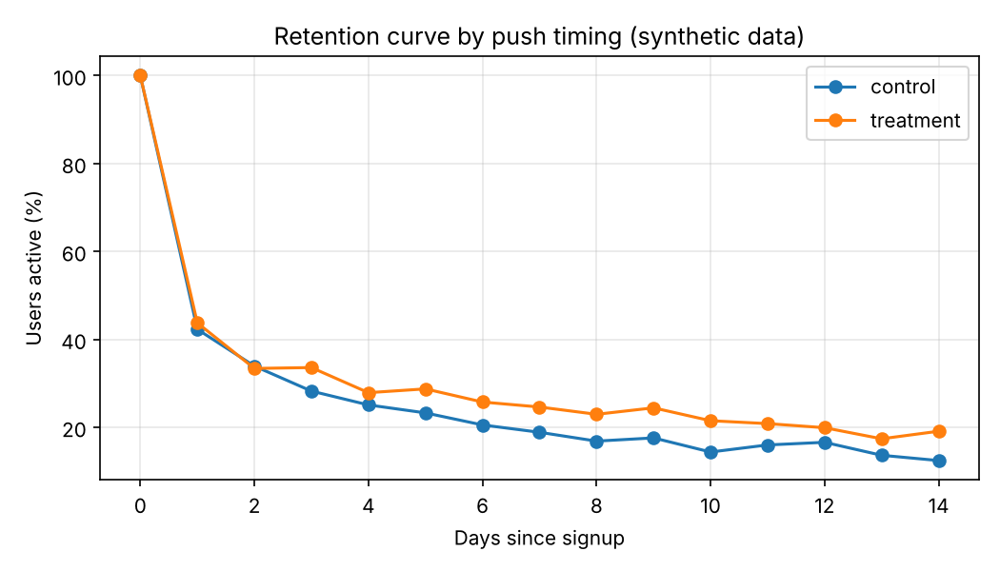

# Findings (SYNTHETIC DATA)

> The data is simulated with planted effects. These numbers show how the analysis works, not real product results.

## Retention by push group

| push_group   |   users |   d1_pct |   d3_pct |   d7_pct |   d14_pct |
|:-------------|--------:|---------:|---------:|---------:|----------:|
| control      |    1494 |     42.3 |     28.2 |     18.9 |      12.4 |
| treatment    |    1506 |     43.8 |     33.6 |     24.6 |      19.1 |

D7 difference: +5.7 points (95% CI +2.8 to +8.6), z = 3.78, p = 0.0002.

## Session length, late night vs other hours

| push_group   | hour_window      |   sessions |   avg_session_min |
|:-------------|:-----------------|-----------:|------------------:|
| control      | late_night_21_24 |       1678 |              7.58 |
| treatment    | late_night_21_24 |       8418 |              9.44 |
| control      | other_hours      |      10065 |              7.79 |
| treatment    | other_hours      |       5283 |              7.9  |

## Push open rate by send window

| push_group   | send_window   |   pushes |   open_rate_pct |
|:-------------|:--------------|---------:|----------------:|
| control      | daytime       |    10458 |            14.6 |
| treatment    | evening_21_23 |    10542 |            23.5 |

## Data quality

| platform   |   raw_events |   duplicate_rows |   duplicate_pct |   missing_length_pct |
|:-----------|-------------:|-----------------:|----------------:|---------------------:|
| android    |        20709 |              419 |            2.02 |                 0    |
| ios        |         5883 |              102 |            1.73 |                10.84 |

Caveat: the treatment group differs from control in push timing only by design, but push timing is confounded with push volume in this toy setup, and no holdout for organic late-night usage exists. A real study would randomize and pre-register these.
